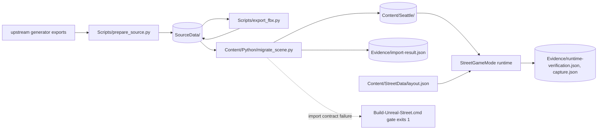

# Architecture overview

## What this repo is

A Windows Unreal Engine 5.8 project that turns a frozen source snapshot of 5th & University into a walkable map with a native C++ runtime and automated evidence.
It runs in the UE editor, `-game` mode, or the packaged Win64 player built by `Build-Unreal-Street.cmd`.
It does not own the upstream building generator (a sibling Unity project referenced by `Scripts/prepare_source.py:12-13`), survey-grade accuracy, or the video/splat reconstruction research (see `docs/research/`).

## Top-level layout

| Path | Purpose | Owner |
| --- | --- | --- |
| `Source/` | `SeattleUnreal` runtime module: game mode (verify/record harness, layout loading), first-person character, HUD; target rules. | `@dafrimer` |
| `Content/` | `Seattle/` imported meshes, materials, textures and `Maps/FifthUniversity` (LFS); `Python/` editor-side importers; `StreetData/layout.json` runtime layout. | `@dafrimer` |
| `Config/` | Engine, game and editor ini: renderer settings, default map, game mode. | `@dafrimer` |
| `Scripts/` | Off-engine pipeline and tooling (Python, PowerShell, Blender). | `@dafrimer` |
| `SourceData/` | Frozen import snapshot: `import-manifest.json`, `FBX/`, `Colliders/`, `Textures/`, attribution. | `@dafrimer` |
| `Evidence/` | Durable verification JSON and review PNGs written by runs. | generated |
| `docs/` | Canonical documentation; see `docs/README.md`. | `@dafrimer` |
| `Binaries/`, `Intermediate/`, `Saved/`, `DerivedDataCache/` | UE build output and caches. Gitignored. | generated |
| `Build/` | Packaged Win64 player from BuildCookRun. Gitignored. | generated |
| `Prerequisites/` | Local copy of the Microsoft Build Tools bootstrapper (hash pinned, not redistributable). Gitignored. | local |

## How it runs

**Entry points**

| Entry point | Trigger | Defined at |
| --- | --- | --- |
| `Scripts/prepare_source.py` | manual, when upstream exports change | `Scripts/prepare_source.py:82` |
| `Scripts/export_fbx.py` (Blender, background) | manual, after prepare_source | `Scripts/export_fbx.py:55` |
| `Content/Python/migrate_scene.py` (UnrealEditor-Cmd) | `Build-Unreal-Street.cmd:7` | `Content/Python/migrate_scene.py:694` |
| `Content/Python/assemble_imported_scene.py` | manual; rebuilds map from saved assets | `Content/Python/assemble_imported_scene.py` |
| `AStreetGameMode::InitGame` (`-StreetVerify` / `-StreetRecord`) | command line | `Source/SeattleUnreal/StreetGameMode.cpp:122-126` |
| `Scripts/encode_walkthrough.py` | manual, after StreetRecord | `Scripts/encode_walkthrough.py` |
| BuildCookRun | `Build-Unreal-Street.cmd:11` | `Build-Unreal-Street.cmd:11` |

**Data flow**

Upstream OBJ/material exports are snapshotted with hashes into `SourceData/`, converted to FBX with baked axes in Blender, and imported by the editor Python into `Content/Seattle/`, which also places all actors into the map and binds the native game mode. At runtime `StreetGameMode` reads `Content/StreetData/layout.json` (route, spawn, wall probes, views) and, in automated modes, writes evidence JSON. The durable state is `SourceData/` (inputs), `Content/Seattle/` (assets) and `Evidence/` (proof).

The planned expansion adds a second producer of buildings (OSM tiles → facade attributes → PCG graph) alongside the hero path; see `docs/decisions/0001` through `0004` and `docs/stories/`.

## External dependencies

| Dependency | Used for | Pinned at | Chosen by |
| --- | --- | --- | --- |
| Unreal Engine 5.8 | engine, editor Python, packaging | `SeattleUnreal.uproject:3` | **no ADR — gap** (inherited from migration) |
| MSVC 14.44 + Windows SDK 22621 + .NET Framework SDK | compiling the runtime | `Scripts/install-build-tools.ps1` | **no ADR — gap** |
| Blender (background) | OBJ → FBX axis conversion | `Scripts/export_fbx.py:2` | **no ADR — gap** |
| Git LFS | binary assets | `.gitattributes` | **no ADR — gap** |
| UE PCG framework (+ beta interops) | generated buildings | not yet enabled | `docs/decisions/0001-generate-buildings-in-unreal-pcg-from-osm.md` |
| Street-imagery vision tagging | facade attributes | not yet chosen | `docs/decisions/0002-derive-facade-appearance-from-street-imagery.md` |
| AMB3R / AMB3R-SLAM | measurement and validation only | not yet installed | `docs/decisions/0003-use-amb3r-for-validation-not-geometry.md` |
| ffmpeg (libx264) | walkthrough MP4 | `Scripts/encode_walkthrough.py:7` (sibling WSL env) | **no ADR — gap** |

## Known gaps

- Upstream generator is outside the repo (`Scripts/prepare_source.py:12-13`), so `SourceData/` cannot be regenerated from a clone; the expansion pipeline must not repeat this.
- Automated runs can exit 0 after a failed verification; trust `success` in the evidence JSON, not the process code.
- Route return error is 24.84 cm against a 25 cm tolerance (`Source/SeattleUnreal/StreetGameMode.cpp:43`) — passing, with no margin.
- `Scripts/encode_walkthrough.py` depends on an ffmpeg inside a sibling project's WSL environment.
- Undocumented decisions: Unreal 5.8, MSVC toolchain, Blender, Git LFS — no ADR.
